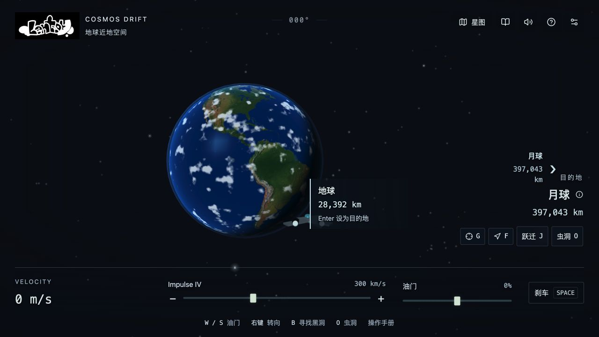

# COSMOS DRIFT

从地球出发的开源 Three.js 太空探索游戏：1315个真实目录天体、连续航速、曲速与虫洞、自动黑洞穿越、10首原创太空配乐。

A browser-based space exploration game with real catalogue objects, precision flight controls, fictional intergalactic travel and an original ambient soundtrack.



## 运行

需要 Node.js 22.12+、npm，以及支持 WebGL2 的现代桌面浏览器。

```sh
git clone https://github.com/lenteyyy/cosmos-drift.git
cd cosmos-drift
npm ci
npm start
```

打开 http://127.0.0.1:5173/ 。服务仅监听本机，独立于启动终端运行。重复启动会复用已有服务；重启电脑后需要再次启动。macOS也可双击 `start.command` / `stop.command`。

```sh
npm run server:status
npm restart
npm stop
npm run dev       # 前台开发服务
npm run build     # 生成 dist，可部署到网站根路径
npm run preview   # 预览构建结果
```

## 飞行

鼠标双击天体选择目的地，右键拖动转向；也可使用方向键转向、Enter选择准星天体、Tab切换附近目标。

W/S调油门，滚轮或+/-连续调速，Alt精调，Shift加速，Space刹车。速度从1厘米/秒到5亿光年/秒，组合横移与加速也受上限约束；粒子与引擎音色随实际航速变化。

J曲速跃迁，O虫洞，F自动驾驶，G对准目标。B选择附近黑洞，靠近或按J抵达边缘后自动捕获，随机到达其他星系或结构；捕获后无法中止、暂停或打开菜单。普通曲速和虫洞可以用Space中止。

M开关星图，I开关资料，保留视角锁定且隐藏光标；Esc关闭。星图中↑↓浏览，/搜索，Enter确认，J出发，+/-缩放，PgUp/PgDn切尺度。A/D横移，Q/E滚转，V切视角，P暂停；更多说明在游戏手册中。

## 内容与声音

目录共1315项：355颗恒星、280颗已确认系外行星、520座星系、107个星系群与结构、30个黑洞系统，以及8颗行星、5颗矮行星、9颗卫星和观测视界。每个独立可见的永久星点都对应可选目录对象。坐标使用扇区与误差补偿，保留深空低速位移。

恒星拥有高亮核心、颗粒表面、光晕与距离亮度衰减。飞行粒子、隧道和宇宙尘埃为程序视觉效果。超光速、虫洞及可穿越黑洞属于科幻玩法；太阳系相位、天体尺寸与结构边界为示意，并非星历或相对论光线追踪。

公开版带10首原创氛围配乐，共16分钟，按场景切换并循环播放。音乐、音效和英文导航语音分别调音量，播报时音乐自动降低。浏览器需要用户首次按键或点击才能开始声音；英文语音取决于本机可用的英语声库。

三首私人MP3与macOS系统语音录音不随仓库分发。本地已有这些素材时，启动或构建会自动识别；缺少它们不会影响公开版。添加或移除可选素材后需重启开发服务。不要将这些素材提交或随构建公开分发。

## 开发与验证

```sh
npm run check          # 类型、35项回归、目录校验、生产构建
npm run release:check  # 已跟踪文件中的私有素材、凭据与个人路径扫描
npm audit
npm run data:build     # 用随仓库提供的快照离线重建目录
npm run data:validate
npm run data:refresh   # 主动刷新上游数据，需要网络
```

`scripts/build-audio.py`可从原创音符和合成算法重建配乐，需要Python 3和numpy。默认保留现有WAV，添加`--force`可全部重建。正常运行、构建和CI不需要Python，也不依赖远程天文API。

GitHub Actions在推送及PR时运行检查与离线重建。审查范围、修复和验证记录见[代码审查记录](docs/AUDIT.md)，贡献要求见[CONTRIBUTING.md](CONTRIBUTING.md)。

## 许可

原始代码、文档、程序视觉素材和10首原创配乐采用[MIT](LICENSE)。派生天文目录与HYG/OpenNGC快照遵循[CC BY-SA 4.0](LICENSES/CC-BY-SA-4.0.txt)，完整来源与哈希位于[来源清单](public/data/sources.json)。Lenteyyy标志保留品牌权利。

NASA地球纹理、天文资料署名及不分发的可选音频说明见[第三方声明](THIRD_PARTY_NOTICES.md)。
